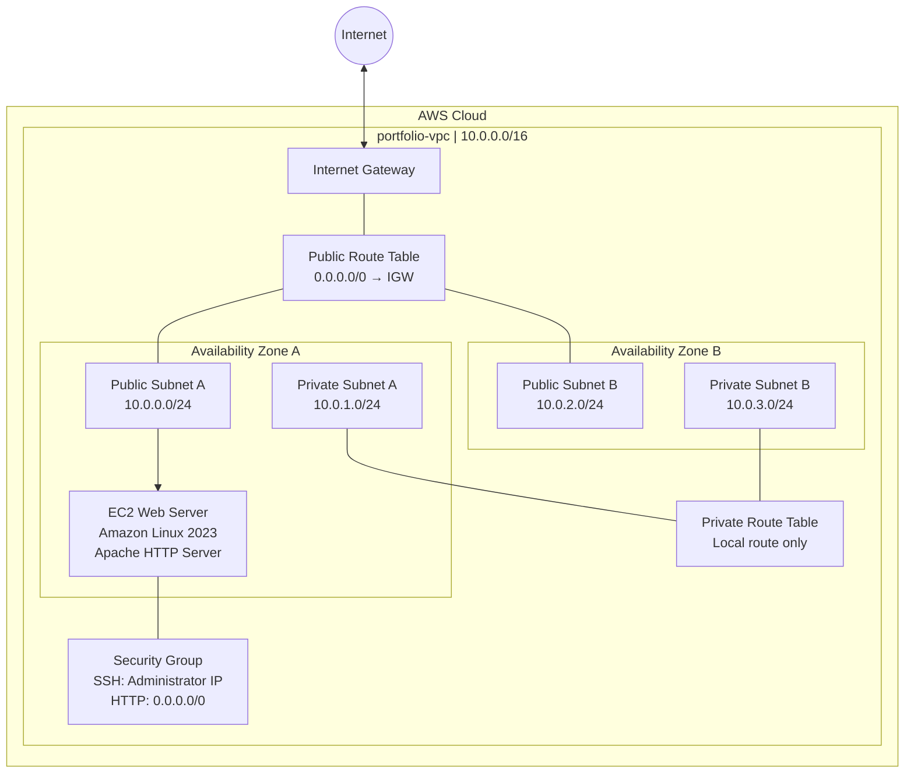

# AWS Infrastructure Architecture Diagram

The following diagram represents the deployed network design.

## Deployment Notes

- One EC2 instance was deployed in Public Subnet A.
- Both public subnets use the public route table.
- Both private subnets use the private route table.
- No NAT Gateway was deployed.
- The diagram represents the network design; not every subnet contains a deployed EC2 instance.

